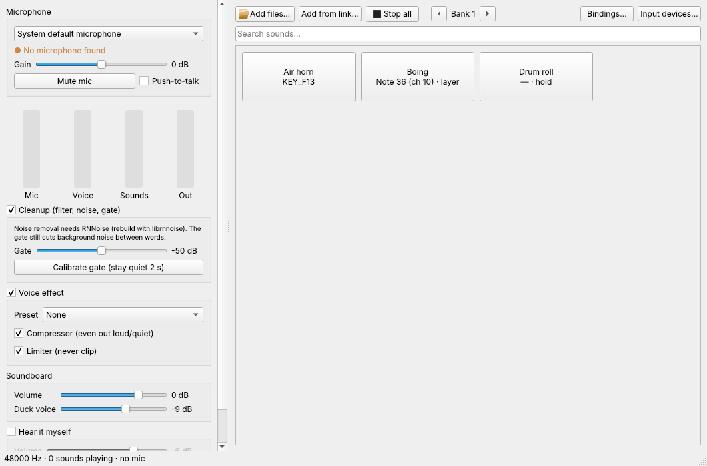

# voxfx

A small Linux voice changer and soundboard for PipeWire. It adds a virtual microphone called
**voxfx Mic**. Select it in Discord or a game, and other people hear your cleaned-up or
effected voice mixed with any sound clips you trigger.



**Status:** working prototype, made for a friend. It isn't a product, so expect rough edges.

## What it does

- **Virtual mic:** real mic → cleanup → voice effect → compressor → mix with sounds → limiter → *voxfx Mic*
- **Mic cleanup:** 80 Hz rumble filter, RNNoise noise removal (if installed), noise gate with
  one-click calibration, compressor, and a limiter that never clips
- **Voice presets:** Deep, Chipmunk, Robot, Radio, Cave
- **Soundboard:**
  - every clip is loudness-normalised (−18 LUFS, −1 dBTP), so no clip is painfully loud
  - per-sound trim
  - your voice ducks automatically while sounds play
  - play modes: once, layer, hold-to-play, loop
- **Record new sounds:** **● Record** captures your voice as others hear it (cleanup + voice
  effect, no soundboard), trims silence, and lets you preview it before saving it with a name
  and image
- **Pads with pictures:** give any sound an image (Edit…, or drop an image file onto its pad).
  Pads show the image on top (**Tiles**) or beside the name (**List**); **Auto** picks by pad
  size, and the size slider resizes them
- **Live feedback:** pads glow and show a progress bar while playing; meters for mic, voice,
  sounds and output
- **Preview:** right-click → Preview plays a sound in your headphones only
- **Hear it yourself:** optional monitor to your headphones (sounds only, or sounds + voice)
- **Triggers:** USB macro pads, spare keyboards/numpads, mouse side buttons, **gamepads** and
  **MIDI pads**
  - learn mode: click "Bind…", then press the key/pad/button
  - 8 banks, so a small pad can reach more sounds
  - MIDI velocity sets the volume
  - a dedicated macro pad can be **grabbed** so its keys never type into other apps
- **Getting sounds:** drag and drop files, or **Add from link…** with a MyInstants or Voicemod sound
  page or a direct .mp3/.ogg/.wav link
- **Scripting:** `voxfx ctl play "air horn"` etc. Bind these in your desktop's own shortcut settings
- **Tray icon:** keeps running when the window is closed, so bindings keep working
- **Dark theme by default.** Switch to Light or "Follow desktop" at the bottom of the left panel

## Build

Dependencies (Debian/Ubuntu names. Arch/Fedora have the same libraries under similar names):

```bash
sudo apt install build-essential cmake ninja-build pkg-config qt6-base-dev \
  libpipewire-0.3-dev libsndfile1-dev libsoxr-dev libebur128-dev libevdev-dev \
  libasound2-dev catch2
```

Optional, for noise removal: `librnnoise-dev` (Arch: `rnnoise`). It is detected automatically.

```bash
cmake -S . -B build -G Ninja
cmake --build build
./build/voxfx
```

To install it system-wide (puts the app in your launcher):

```bash
sudo cmake --install build
```

## Ready-made build

`tools/make_portable.sh` produces `dist/voxfx-<version>-linux-x86_64.tar.gz`. It's a
self-contained folder with Qt and the audio libraries bundled; PipeWire, ALSA, graphics
drivers and other base libraries come from the system. Extract it and run `./install.sh`,
which needs no root and works on immutable distros like Bazzite. That adds voxfx to the app
menu and puts a `voxfx` command in `~/.local/bin`. `START-HERE.txt` inside the folder is
the user guide.

The result needs the glibc of the machine that built it, or newer (the script prints the
minimum). Build on the oldest distro you want to support.

## First run

1. Pick your real microphone at the top left. "System default" follows your desktop setting.
2. In Discord (or OBS, or a game), set the input device to **voxfx Mic**. In Discord, turn off
   its own noise suppression/echo cancellation if your voice sounds processed twice.
3. Stay quiet and click **Calibrate gate**.
4. Add sounds (＋ Add, drag and drop, or ● Record), then right-click a pad →
   **Bind key / pad / button…**. Right-click → **Edit…** sets the name, image, volume and play mode.

### Macro pads, keyboards and gamepads need input permission

voxfx reads keys directly from `/dev/input`, which works on every desktop (X11, GNOME, KDE,
Hyprland, …). Your user needs read access. Either:

- the simple option, then log out and back in:

  ```bash
  sudo usermod -aG input $USER
  ```

  The catch: this lets your user's apps read every keyboard.
- or the tighter option: grant access to just your macro pad with the udev rule in
  `packaging/70-voxfx-input.rules` (instructions inside).

voxfx only acts on keys you have bound and never logs keystrokes.

**Grabbing** (Input devices… → Grab) makes a device's keys reach only voxfx. Use it for a
dedicated macro pad, never your main keyboard. "Release grabbed devices" in the tray menu
undoes it.

MIDI pads need no setup: they are connected automatically, including when you plug them in later.

### Keyboard shortcuts through your desktop instead

If you'd rather not grant input access, bind desktop shortcuts to commands such as:

```bash
voxfx ctl play "air horn"
```

```bash
voxfx ctl stop
```

The full command list is `play <name>`, `stop`, `mute`, `unmute`, `toggle-mute`, `ptt-down`,
`ptt-up`, `preset <name>`, `bank <n>`, `record-start`, `record-stop [name]`, `list`, and `show`.

## Where things are stored

| What | Where |
|---|---|
| Sounds + bindings | `~/.local/share/voxfx/library.json` and `~/.local/share/voxfx/sounds/` |
| Pad images (256 px PNGs) | `~/.local/share/voxfx/images/` |
| Settings | `~/.config/voxfx/voxfx.conf` |

## About "Add from link"

MyInstants and Voicemod have no public API. The importer downloads the page you paste,
finds the audio file on it (`og:audio` tags, `<audio>` tags, or `play('…mp3')` buttons), and
saves that one file. It only runs when you ask, one request at a time.

If a site changes its layout, imports from it stop working. Then fix
`src/sources/link_resolver.cpp` and add a sample page to `tests/fixtures/`. The clips are other
people's uploads, so keep them for personal use. Respect the sites' terms and don't bulk-download.

## Development

Code layout:

```
src/engine/   PipeWire graph: virtual mic, processing node, links (engine.cpp)
src/dsp/      filters, gate, compressor, limiter, pitch/robot/radio/reverb, RNNoise wrapper
src/sfx/      clip decoding + loudness normalisation, real-time voice pool, recorder
src/input/    evdev (keys/macro pads/gamepads), ALSA MIDI, binding manager
src/sources/  library (JSON), link resolver + importer
src/ui/       Qt widgets (pad_grid: custom pads; theme: palettes + style sheet);
              app.cpp ties everything together
tools/        engine smoke test, headless end-to-end scripts, portable bundle builder
packaging/    desktop file, icon, udev rule example, files shipped in the portable bundle
```

Testing is deliberately light, enough to catch regressions in the parts that are easy to break:

```bash
ctest --test-dir build
```

This runs unit tests for the DSP, queues, voice pool, bindings, link resolver, clip loader and
recorder.

```bash
tools/e2e_pipewire.sh build
```

This starts a throwaway PipeWire + WirePlumber session (no sound card needed), feeds a test
voice and a clip into the engine, and checks that an app recording "voxfx Mic" hears both.

```bash
tools/e2e_app.sh build
```

This does the same for the full GUI app (offscreen). It seeds a library, plays a sound with
`voxfx ctl play`, records a new sound from a fake mic with `record-start`/`record-stop`, plays
it back after the live voice has stopped, and checks that "voxfx Mic" heard both. It also saves
screenshots of the window, the record and edit dialogs, and a small window. `THEME=light`,
`LAYOUT=list` and `SHOT_DIR=…` change the look and where the images go.

With `VOXFX_DEV=1` set, `voxfx ctl dev-screenshot <file>` (or `record:<file>`, `edit:<id>:<file>`,
`size:<w>x<h>:<file>`) captures the UI, which helps when working on it headless.

The end-to-end scripts need `pipewire`, `wireplumber`, `dbus-run-session` and `python3`.

Real-time rules in the audio callback (`Engine::Impl::process`): no locks, no allocation, no
I/O. Commands come in through a lock-free queue, recordings leave through a lock-free ring
drained by a worker thread, and clips are removed by nulling their slot and freeing them two
audio cycles later (`App::retire`/`App::reap`).

## Known gaps (prototype)

- Desktop-portal global shortcuts aren't implemented. Use evdev bindings or `voxfx ctl`.
- No search inside MyInstants/Voicemod. Paste a link per sound.
- Nothing has been tested against a real mic, macro pad, gamepad or MIDI pad yet. The development
  container had no hardware: the audio path was tested with virtual devices, and input with unit
  tests. Please report what breaks.
- The pitch shifter is a simple low-latency design. It sounds "voice-changer-y", not studio-clean.
